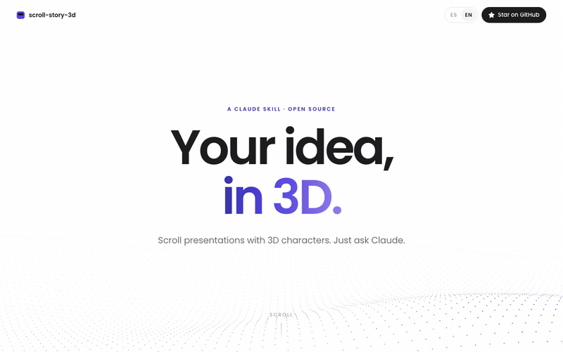
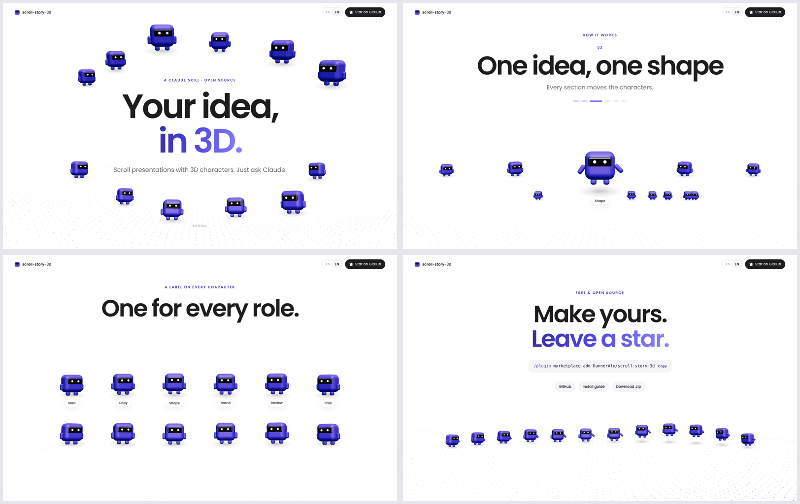
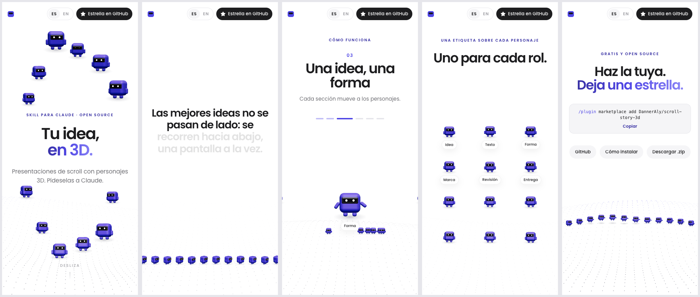
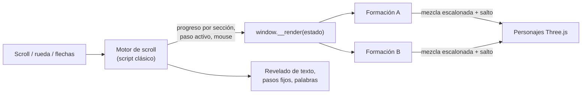

<div align="center">

<a href="https://danneraly.github.io/scroll-story-3d/?lang=es"></a>

# Scroll Story 3D

**Una skill para Claude que convierte tu idea en una presentación de scroll estilo Apple, con un equipo de personajes 3D animados que cambian de formación en cada sección.**

Un solo archivo HTML. Sin build. Solo pídeselo a Claude.

[**▶ Demo en vivo**](https://danneraly.github.io/scroll-story-3d/?lang=es) · [Instalar](#instalar) · [Uso](#uso) · [Cómo funciona](#cómo-funciona) · [🇺🇸 English](README.md)

[](LICENSE)
[](https://code.claude.com/docs/en/skills)
[](https://threejs.org)
[](#)
[](https://github.com/DannerAly/scroll-story-3d/stargazers)

</div>

---

La mayoría de las presentaciones se pasan de lado. Esta **se recorre hacia abajo**: una idea por pantalla, tipografía enorme, casi nada de texto y un grupito de personajes 3D de bloques que caminan, saltan, saludan, siguen al mouse y se acomodan en una nueva **formación** cada vez que avanzas.

Tú cuentas la idea. Claude escribe el contenido, lo reduce a pocas palabras por pantalla, elige una formación para cada idea, le pone tu marca, saca capturas en escritorio y celular para detectar choques, y te entrega un único `.html` que puedes abrir, enviar o publicar donde quieras.

## Qué trae

- 🎬 **Un solo archivo HTML.** Sin framework, sin bundler, sin `npm install`.
- 🤖 **Personajes 3D originales** (Three.js): cuerpo redondeado, visor brillante, ojos que parpadean, patas que caminan, saltitos y mirada que sigue al cursor.
- 🧩 **6 formaciones listas:** `hero`, `parade`, `steps`, `grid`, `ring`, `party`. Agregar una nueva es escribir una función.
- 🍎 **Diseño estilo Apple:** fondo blanco, tipografía grande y apretada, un solo color de marca, revelados con blur y títulos en degradé.
- 🧈 **Scroll suave** (Lenis), secciones fijas de varios pasos y una frase que se ilumina palabra por palabra.
- ⌨️ **Preséntala como slides:** ↑ ↓ ← →, espacio y Re Pág/Av Pág saltan a la siguiente parada.
- 📱 **Responsive:** cada formación se calcula en fracciones de la pantalla, así que funciona en escritorio y celular.
- 📸 **Revisión visual incluida:** un script con Chrome sin ventana saca capturas en cualquier posición del scroll, y Claude revisa el resultado antes de entregarlo.
- 🏷️ **Etiquetas HTML** proyectadas sobre cada personaje para nombres y roles (texto nítido, no texto 3D).
- ♿ Respeta `prefers-reduced-motion`. Si WebGL falla, el texto sigue funcionando.

## Instalar

### Claude Code (recomendado)

Dentro de Claude Code:

```text
/plugin marketplace add DannerAly/scroll-story-3d
/plugin install scroll-story-3d@danneraly
```

O desde la terminal:

```bash
claude plugin marketplace add DannerAly/scroll-story-3d
claude plugin install scroll-story-3d@danneraly
```

### Manual (carpeta de skills)

```bash
git clone https://github.com/DannerAly/scroll-story-3d.git
cp -r scroll-story-3d/skills/scroll-story-3d ~/.claude/skills/
```

### Claude.ai y Claude Desktop

1. Descarga **`scroll-story-3d.zip`** desde el [último release](https://github.com/DannerAly/scroll-story-3d/releases/latest).
2. En Claude, ve a **Customize → Skills**, toca **+ → Create skill → Upload a skill** y elige el zip.

## Uso

Solo describe lo que quieres. La skill se activa sola cuando pides una presentación de scroll, un pitch, una propuesta o una landing con animaciones o 3D:

> Haz una presentación de scroll estilo Apple para mi proyecto de grado.

> Arma un pitch para mi cafetería, color de marca #C2410C, con 5 pasos.

> Convierte esta propuesta en una landing de scroll con personajes 3D, uno por cada rol del equipo: *(pega tu documento)*

Lo que hace Claude, en orden:

1. **Contenido primero.** Escribe la historia completa en un `.md` (qué, para quién, por qué, cómo, prueba, cierre) y la reduce a 2–8 palabras por pantalla.
2. **Guion de secciones.** Una idea = una sección = una formación 3D.
3. **Copia la plantilla** y ajusta tu color de marca, tipografía y nombres de los personajes.
4. **Escribe las secciones.**
5. **Saca capturas** en escritorio (1440×900) y celular (390×844) para encontrar texto que se pisa con los personajes o etiquetas cortadas en los bordes.
6. **Abre el archivo** en tu navegador y te resume cada sección.

## Galería

<a href="https://danneraly.github.io/scroll-story-3d/"></a>

<a href="https://danneraly.github.io/scroll-story-3d/?lang=es"></a>

## Patrones de sección

Cada patrón es una `<section>` con un atributo `data-f` que elige la formación 3D.

| Patrón | `data-f` | Qué hacen los personajes | Texto en pantalla |
|---|---|---|---|
| Portada | `hero` | Rodean el título y caen rebotando al cargar | Eyebrow + h1 de 2 líneas (la 2ª en degradé) + 1 línea |
| Frase que se ilumina | `parade` | Caminan en fila al pie mientras una frase de 12–20 palabras se enciende palabra por palabra | Solo la frase |
| Pasos | `steps` | Carrusel: el paso activo salta al frente y los demás se alejan a los lados con su etiqueta | Número + h3 + 1 línea por paso |
| Grilla con etiquetas | `grid` | Se paran en grilla, cada uno con su nombre | Eyebrow + h2 |
| Ronda | `ring` | Giran alrededor del texto | h2 + 1 línea |
| Cierre | `party` | Arco al pie que salta en ola | Eyebrow + h2 + chips |

## Cómo funciona



- Cada `<section data-f="nombre">` tiene un **rango de scroll** donde su formación se mantiene. Entre una sección y otra, cada personaje pasa de una formación a la siguiente con su propio retraso y un saltito.
- Una **formación** es una función `(i, c) => ({ x, y, z, s, yaw, look, label, walk, active, wave, hopL })`. Las posiciones se escriben en fracciones de `c.V.w` / `c.V.h` (el mundo visible en z = 0) y `c.u` (una unidad que escala con la pantalla), así que la misma formación sirve en cualquier pantalla.
- Las secciones fijas (`data-pin`) quedan pegadas mientras sus pasos cambian con un cruce suave.

## Personalizar

Marca, en `:root`:

```css
:root{
  --font:'Poppins';
  --accent:#4F46E5;      /* tu color de marca: eyebrow, degradé y personajes */
  --accent-d:#3730A3;
  --grad:linear-gradient(95deg,#3730A3 0%,#4F46E5 45%,#8B85F7 100%);
}
```

Personajes, en el script de la escena:

```js
const CONFIG = {
  roles: ['Diseño', 'Producto', 'Desarrollo', 'Pruebas', 'Seguridad', 'Lanzamiento'], // uno por paso, con etiqueta
  extras: 6, // personajes sin etiqueta para que las formaciones se vean llenas
};
```

Una formación nueva: agrega la función en `F`, su peso del campo de puntos en `FIELD` y una sección con ese `data-f`:

```js
// fila al pie
fila(i, c) {
  return { x: (i / (N - 1) - 0.5) * c.V.w * 0.8, y: -c.V.h * 0.36, s: c.u * 0.26, look: 1 };
},
```

Más recetas (columna a la derecha, arco detrás de alguien, un solo personaje al frente, dentro de una caja inclinada) en [`references/patterns.md`](skills/scroll-story-3d/references/patterns.md).

## Script de capturas

`scripts/shoot.mjs` abre Chrome sin ventana por DevTools, hace scroll a cada posición (en altos de pantalla) y guarda un PNG. También reporta errores de JS.

```bash
# copia de prueba sin Lenis (Lenis interfiere con scrollTo en Chrome sin ventana)
sed 's#<script src="https://unpkg.com/lenis[^"]*"></script>#&<script>window.Lenis=undefined;</script>#' pagina.html > /tmp/prueba.html
node skills/scroll-story-3d/scripts/shoot.mjs "file:///tmp/prueba.html" ./capturas 1440 900 "0,0,1.7,4.5"
```

Necesita Node 22+ y Google Chrome (en Linux o Windows define `CHROME=/ruta/a/chrome`).

## Qué hay adentro

```text
scroll-story-3d/
├── .claude-plugin/
│   ├── marketplace.json      # para que /plugin marketplace add lo encuentre
│   └── plugin.json
├── skills/scroll-story-3d/   # la skill
│   ├── SKILL.md              # flujo, reglas de diseño y notas del motor
│   ├── template/index.html   # motor de scroll + escena 3D + 6 formaciones
│   ├── references/patterns.md
│   └── scripts/shoot.mjs     # capturas sin ventana para revisar
└── docs/index.html           # el demo en vivo, hecho con la skill
```

## Requisitos

- Cualquier navegador moderno con WebGL.
- Internet al abrirla: Three.js, Lenis y Google Fonts se cargan de CDN.

## Contribuir

Nuevas formaciones, patrones de sección y traducciones son muy bienvenidos. ¿Hiciste algo con la skill? Abre un issue con una captura o GIF y puede terminar en la galería.

## Apoya el proyecto

Si te salvó de otra presentación de lado a lado, **[dale una ⭐](https://github.com/DannerAly/scroll-story-3d/stargazers)**. Ayuda muchísimo a que otros la encuentren.

<a href="https://star-history.com/#DannerAly/scroll-story-3d&Date">
  
</a>

## Licencia

[MIT](LICENSE) © 2026 [Aly Danner](https://github.com/DannerAly)
