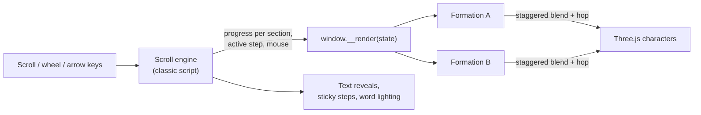

<div align="center">

<a href="https://danneraly.github.io/scroll-story-3d/"></a>

# Scroll Story 3D

**A Claude skill that turns your idea into an Apple‑style scroll presentation, with a crew of animated 3D characters that regroup on every section.**

One HTML file. No build step. Just ask Claude.

[**▶ Live demo**](https://danneraly.github.io/scroll-story-3d/) · [Install](#install) · [Usage](#usage) · [How it works](#how-it-works) · [🇪🇸 Español](README.es.md)

[](LICENSE)
[](https://code.claude.com/docs/en/skills)
[](https://threejs.org)
[](#)
[](https://github.com/DannerAly/scroll-story-3d/stargazers)

</div>

---

Most decks slide sideways. This one **scrolls**: one idea per screen, huge type, almost no text, and a little crew of 3D block characters that walk, hop, wave, follow your mouse and line up into a new **formation** every time you move on.

You describe the pitch. Claude writes the content, cuts it down to a few words per screen, picks a formation for each idea, brands it, screenshots it on desktop and mobile to catch overlaps, and hands you a single `.html` file you can open, send or host anywhere.

## Features

- 🎬 **One self‑contained HTML file.** No framework, no bundler, no `npm install`.
- 🤖 **Original 3D characters** (Three.js): rounded bodies, glossy visor, blinking eyes, walking legs, little hops, and eyes that follow the cursor.
- 🧩 **6 formations out of the box:** `hero`, `parade`, `steps`, `grid`, `ring`, `party`. Adding your own is one function.
- 🍎 **Apple‑style design:** white canvas, big tight type, one brand color, blur‑in reveals, gradient headlines.
- 🧈 **Smooth scrolling** (Lenis) with sticky multi‑step sections and a sentence that lights up word by word.
- ⌨️ **Present it like slides:** ↑ ↓ ← →, Space and Page Up/Down jump to the next stop.
- 📱 **Responsive:** every formation is laid out in fractions of the viewport, so it works on desktop and phones.
- 📸 **Visual QA built in:** a headless‑Chrome script takes screenshots at any scroll position, so Claude checks the result before handing it over.
- 🏷️ **HTML labels** projected over each character for names and roles (crisp text, not 3D text).
- ♿ Respects `prefers-reduced-motion`. If WebGL fails, the text still works.

## Install

### Claude Code (recommended)

Inside Claude Code:

```text
/plugin marketplace add DannerAly/scroll-story-3d
/plugin install scroll-story-3d@danneraly
```

Or from your terminal:

```bash
claude plugin marketplace add DannerAly/scroll-story-3d
claude plugin install scroll-story-3d@danneraly
```

### Manual (skills folder)

```bash
git clone https://github.com/DannerAly/scroll-story-3d.git
cp -r scroll-story-3d/skills/scroll-story-3d ~/.claude/skills/
```

### Claude.ai and Claude Desktop

1. Download **`scroll-story-3d.zip`** from the [latest release](https://github.com/DannerAly/scroll-story-3d/releases/latest).
2. In Claude, go to **Customize → Skills**, click **+ → Create skill → Upload a skill**, and pick the zip.

## Usage

Just describe what you want. The skill triggers on its own when you ask for a scroll presentation, a pitch, a proposal or a landing page with animation or 3D:

> Make a scroll presentation for my coffee‑shop pitch. Brand color #C2410C, 5 steps, Apple style.

> Turn this proposal into a scroll landing with 3D characters, one per team role: *(paste your doc)*

> Haz una presentación de scroll estilo Apple para mi proyecto de grado.

What Claude does, in order:

1. **Content first.** Writes the full story in a `.md` (what, for whom, why, how, proof, close), then cuts it to 2–8 words per screen.
2. **Section script.** One idea = one section = one 3D formation.
3. **Copies the template** and sets your brand color, font and character names.
4. **Writes the sections.**
5. **Screenshots** on desktop (1440×900) and mobile (390×844) to catch text that collides with characters or labels cut at the edges.
6. **Opens the file** in your browser and summarizes each section.

> [!NOTE]
> The skill's instructions are written in Spanish. Claude follows them in any language, and your presentation comes out in whatever language you ask for.

## Gallery

<a href="https://danneraly.github.io/scroll-story-3d/"></a>

<a href="https://danneraly.github.io/scroll-story-3d/?lang=es"></a>

## Section patterns

Each pattern is a `<section>` with a `data-f` attribute that picks the 3D formation.

| Pattern | `data-f` | What the characters do | Text on screen |
|---|---|---|---|
| Cover | `hero` | Circle the headline and drop in with a bounce on load | Eyebrow + two‑line h1 (second line in gradient) + one line |
| Sentence that lights up | `parade` | Walk in a line along the bottom while a 12–20 word sentence lights up word by word | Just the sentence |
| Steps | `steps` | Carousel: the active step jumps up front, the rest step back to the sides with their label | Number + h3 + one line per step |
| Labeled grid | `grid` | Stand in a grid with a name tag each | Eyebrow + h2 |
| Ring | `ring` | Orbit around the text | h2 + one line |
| Call to action | `party` | Arc along the bottom, hopping in a wave | Eyebrow + h2 + chips |

## How it works



- Every `<section data-f="name">` owns a **scroll range** where its formation holds. Between two sections, each character interpolates from one formation to the next with its own small delay and a little jump.
- A **formation** is a function `(i, c) => ({ x, y, z, s, yaw, look, label, walk, active, wave, hopL })`. Positions are written in fractions of `c.V.w` / `c.V.h` (the visible world at z = 0) and `c.u` (a unit that scales with the screen), so the same formation works on any screen.
- Pinned sections (`data-pin`) stay sticky while their steps cross‑fade.

## Customize

Brand, in `:root`:

```css
:root{
  --font:'Poppins';
  --accent:#4F46E5;      /* your brand color: eyebrow, gradient and characters */
  --accent-d:#3730A3;
  --grad:linear-gradient(95deg,#3730A3 0%,#4F46E5 45%,#8B85F7 100%);
}
```

Characters, in the scene script:

```js
const CONFIG = {
  roles: ['Design', 'Product', 'Engineering', 'QA', 'Security', 'Launch'], // one per step, with a label
  extras: 6, // unlabeled characters so formations look full
};
```

A new formation: add a function to `F`, its dot‑field weight to `FIELD`, and a section with that `data-f`:

```js
// a row along the bottom
row(i, c) {
  return { x: (i / (N - 1) - 0.5) * c.V.w * 0.8, y: -c.V.h * 0.36, s: c.u * 0.26, look: 1 };
},
```

More recipes (right column, arc behind someone, a single hero character, inside a tilted box) are in [`references/patterns.md`](skills/scroll-story-3d/references/patterns.md).

## Visual QA script

`scripts/shoot.mjs` opens headless Chrome over DevTools, scrolls to each position (in screen heights) and saves a PNG. It also reports JS errors.

```bash
# test copy without Lenis (Lenis fights scrollTo in headless Chrome)
sed 's#<script src="https://unpkg.com/lenis[^"]*"></script>#&<script>window.Lenis=undefined;</script>#' page.html > /tmp/test.html
node skills/scroll-story-3d/scripts/shoot.mjs "file:///tmp/test.html" ./shots 1440 900 "0,0,1.7,4.5"
```

Requires Node 22+ and Google Chrome (set `CHROME=/path/to/chrome` on Linux or Windows).

## What's inside

```text
scroll-story-3d/
├── .claude-plugin/
│   ├── marketplace.json      # lets /plugin marketplace add find it
│   └── plugin.json
├── skills/scroll-story-3d/   # the skill itself
│   ├── SKILL.md              # workflow, design rules and engine notes
│   ├── template/index.html   # scroll engine + 3D scene + 6 formations
│   ├── references/patterns.md
│   └── scripts/shoot.mjs     # headless screenshots for QA
└── docs/index.html           # the live demo, made with the skill
```

## Requirements

- Any modern browser with WebGL.
- An internet connection when viewing: Three.js, Lenis and Google Fonts load from CDNs.

## Contributing

New formations, section patterns and translations are very welcome. Built something with it? Open an issue with a screenshot or GIF and it may end up in the gallery.

## Support

If this saved you from another sideways deck, **[give it a ⭐](https://github.com/DannerAly/scroll-story-3d/stargazers)**. It really helps others find it.

<a href="https://star-history.com/#DannerAly/scroll-story-3d&Date">
  
</a>

## License

[MIT](LICENSE) © 2026 [Aly Danner](https://github.com/DannerAly)
